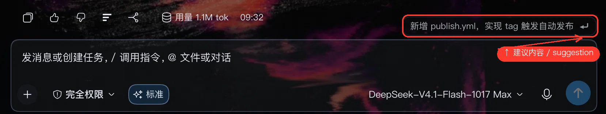

# dsh-saynext

[中文](README.md) · [English](README.en.md)

Adds a "next line" to the DSH composer: after each turn finishes, it guesses the sentence you are most
likely to say next and leaves it just above the input box. Press **Enter** to drop it into the composer
(**nothing is sent**); press **Enter** again to send.



> The grey line inside the red box is the suggestion. While it sits above the composer it takes no focus
> and swallows no keys — you can ignore it entirely.

## What it does

- When a turn ends **normally**, the host asks the model once, using the last 4 turns of that session, for
  one sentence you could send as-is.
- When the composer is empty and no turn is running, that sentence shows as a grey pill above the composer.
- Enter while the composer has focus: the sentence is copied into the composer and **not sent**; a second
  Enter sends it.
- Enter anywhere else (sidebar search, settings field, rename box): nothing happens, the pill stays put.
- The pill hides itself while the composer already has text or while a turn is still streaming.

## Install

Published on npm: <https://www.npmjs.com/package/dsh-saynext>

```bash
cd ~/.dsh/profiles/desktop
pnpm add dsh-saynext
```

Then add `dsh-saynext` to the `dsh.profile.bundles` array in `package.json` and run `pnpm install` once more.
Once the plugin is listed in the market you can simply install it from **Settings → Plugin Market**, which
registers the bundle for you.

For local development a link is easier:

```json
"dsh-saynext": "link:/absolute/path/to/dsh-saynext"
```

`lib/index.js` imports `@deepseek-ai/schemastery` at runtime (shipped inside DSH, not published to npm, hence
declared as a peer dependency). With an npm install it resolves from the profile's `node_modules`; with a link
install where Node cannot resolve it, add one symlink:

```bash
mkdir -p node_modules/@deepseek-ai
ln -s ~/.dsh/profiles/desktop/node_modules/@deepseek-ai/schemastery \
      node_modules/@deepseek-ai/schemastery
```

## One full interaction

1. You send a message and wait for the answer.
2. The turn ends and the composer is empty — a grey pill appears above it (e.g. `新增 publish.yml，实现 tag 触发自动发布`).
3. Press Enter: the sentence lands in the composer, cursor at the end, **nothing sent**.
4. Edit it or send it with a second Enter.
5. Do not want it? Delete and type your own; the next turn produces a fresh one.

## Payload

There is exactly one channel between host and UI: the `hint` field of the plugin's settings namespace
`saynext`, holding a JSON string.

```json
{
  "rev": 4,
  "items": [
    {
      "sessionId": "session-…",
      "text": "新增 publish.yml，实现 tag 触发自动发布",
      "turn": 12,
      "rev": 4,
      "at": 1763624000000
    }
  ]
}
```

The UI reads this configuration once a second and only accepts the entry whose `sessionId` matches the
current session, so several sessions running in parallel never see each other's suggestion.

## Boundaries

| Situation | Behaviour |
| --- | --- |
| Turn did not end normally (aborted, failed) | no new suggestion, the previous one stays |
| A turn is streaming | pill hidden, no interference |
| Composer already has text | pill hidden, no interference |
| Focus outside the composer | Enter is not intercepted |
| Several sessions open | one suggestion each, up to 8 cached |

Be clear about the cost: **one extra model call after every turn** (last 4 turns of that session, at most
4000 characters in, 400 tokens out, 20 second timeout). Those tokens are billed to you. If you do not want
it, uninstall the plugin.

## Development

```
lib/index.js     host: watch turn/end, call the model, write `hint`
lib/client.js    UI: read `hint`, draw the pill, intercept Enter
cordis.patch.yml mount declaration
assets/          screenshot
```

- Changing `lib/index.js` (host) needs an **app restart**; host plugins load once at startup.
- Changing only `lib/client.js` (UI) needs a window reload.

After installation the mount block appears in `~/.dsh/profiles/desktop/cordis.patch.yml`:

```yaml
- insert:
  - id: saynext
    name: dsh-saynext
```

To debug, start with `DSH_SAYNEXT_TRACE=1` and the host writes each step to `/tmp/dsh-saynext.log`; by
default it writes nothing.

## License

MIT, see [LICENSE](LICENSE).
