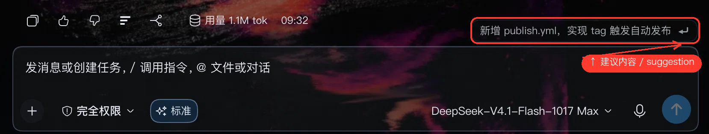

# dsh-saynext

[中文](README.md) · [English](README.en.md)

给 DSH 的输入框加一条「下一句」：每轮回答正常结束后，猜出你接下来最可能说的那一句，
放在输入框上方。按 **Enter** 把它搬进输入框（**不发送**），再按一次 **Enter** 才发出去。



> 红框里那行灰字就是建议。它停在输入框上方时不抢焦点、不吃按键，你可以完全无视它。

## 它做什么

- 一条会话的一轮**正常收尾**时，宿主拿这条会话最近 4 轮对话问一次模型，要一句可以直接发送的指令。
- 输入框为空、且这条会话没有回合在跑时，这句话显示成输入框上方的灰字胶囊。
- 焦点在输入框里按 Enter：只把这句话填进输入框，**不发送**；再按一次 Enter 才真正发出。
- 焦点在别处（侧栏搜索、设置项、重命名框）按 Enter：插件不碰这个键，胶囊原地不动，那个控件照常响应。
- 输入框里已经有字、或正在流式输出时，胶囊自动隐藏。

## 安装

已经发在 npm：<https://www.npmjs.com/package/dsh-saynext>

```bash
cd ~/.dsh/profiles/desktop
pnpm add dsh-saynext
```

装完把 `dsh-saynext` 加进 `package.json` 的 `dsh.profile.bundles` 数组，再 `pnpm install` 一次。
市场收录之后，也可以直接在 **设置 → 插件市场** 搜 dsh-saynext 安装。

本地改代码时用 link 更顺手：

```json
"dsh-saynext": "link:/绝对路径/到/dsh-saynext"
```

`lib/index.js` 依赖运行时的 `@deepseek-ai/schemastery`（DSH 自带，已声明为 peer 依赖，免得装出第二份）。
npm 会顺带装一份 peer；这个 profile 关掉了「自动安装 peer」，所以用 pnpm 时不会再装一份，直接由 DSH 运行时提供。
用 link 安装、且项目目录里 Node 解析不到时，补一条软链：

```bash
cd /绝对路径/到/dsh-saynext      # 下一条命令必须在这个目录里执行
mkdir -p node_modules/@deepseek-ai
ln -s ~/.dsh/profiles/desktop/node_modules/@deepseek-ai/schemastery \
      node_modules/@deepseek-ai/schemastery
```

## 一次完整的交互

1. 你发一条消息，等它答完。
2. 回答结束、输入框为空 —— 上方出现灰字胶囊（例：`新增 publish.yml，实现 tag 触发自动发布`）。
3. 按 Enter：这句话落进输入框，光标在末尾，**没有发送**。
4. 想改就改，想发就再按一次 Enter。
5. 不想要这版建议，直接删掉重写即可；下一轮结束后会重新生成。

## 载荷格式

宿主与界面之间只有一条通道：插件配置命名空间 `saynext` 的 `hint` 字段，内容是一段 JSON 字符串，
整体形如 `{"rev": 4, "items": [ … ]}`。`items` 里每条记录包含这些字段：

| 字段 | 含义 |
| --- | --- |
| `sessionId` | 这条建议属于哪条会话 |
| `text` | 建议正文 |
| `turn` | 产生它的回合号 |
| `rev` | 载荷版本，界面靠它判断有没有变化 |
| `at` | 生成时间戳（毫秒） |

界面每秒读一次这份配置，只认 `sessionId` 与当前会话相同的那一条，所以多条会话同时跑着也互不串台。

## 边界

| 情况 | 行为 |
| --- | --- |
| 一轮没正常收尾（中断、报错） | 不生成建议，保留上一条 |
| 正在流式输出 | 胶囊隐藏，不打断阅读 |
| 输入框已有文字 | 胶囊隐藏，不挡你输入 |
| 焦点不在输入框 | 插件不拦截该键，胶囊不动 |
| 同时开多条会话 | 各自一条建议，最多缓存 8 条 |

代价说清楚：**每轮结束后会多调一次模型**（取这段对话最近 4 轮、最多 4000 字，输出上限 400 token，20 秒超时），
这部分 token 算在你自己头上。不想要就直接卸掉插件。

## 开发

```
lib/index.js    宿主侧：监听 turn/end、调模型、写 hint
lib/client.js   界面侧：读 hint、画胶囊、接管 Enter
cordis.patch.yml 挂载声明
assets/         截图
```

- 改 `lib/index.js`（宿主）要**重启 App** 才生效，宿主插件只在启动时加载一次。
- 只改 `lib/client.js`（界面）刷新窗口即可。

安装后可在 `~/.dsh/profiles/desktop/cordis.patch.yml` 里看到挂载块：

```yaml
- insert:
  - id: saynext
    name: dsh-saynext
```

排查问题时设 `DSH_SAYNEXT_TRACE=1` 再启动，宿主会把每一步写进 `/tmp/dsh-saynext.log`；默认不写文件。

## 许可

MIT，见 [LICENSE](LICENSE)。
